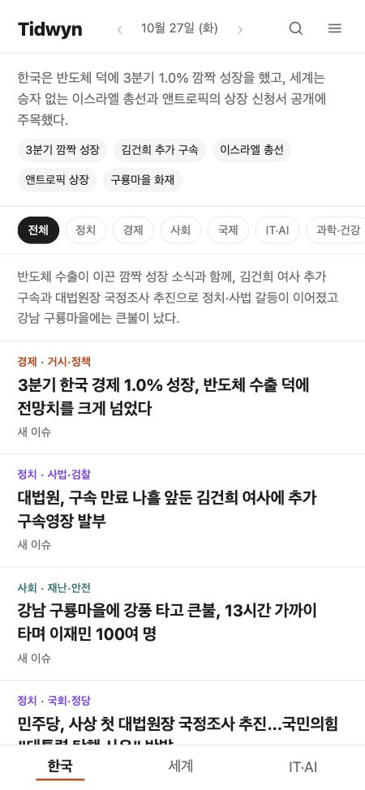

# Tidwyn

[한국어](README.md)

A personal news archive. Every day, AI gathers Korean, world, and IT/AI news, rewrites it in plain Korean, and links stories into issues so you can follow how events unfold.

- Site: <https://tidwyn.vercel.app>



## What it does

- **Daily briefs:** Top stories and short items in three sections (Korea, World, IT/AI). Each story has a one-line summary, why it matters, background, key facts, outlook, and sources.
- **Ongoing stories:** Stories are linked into issues, with earlier developments, an issue summary, a timeline, and related issues.
- **People, organizations, and countries:** Each one that appears in the news has a page with a one-line description and the stories and issues it appears in.
- **Glossary:** Difficult terms are collected with plain explanations. Tapping an underlined word in an expanded card opens its explanation right there.
- **Schedule calendar:** Upcoming official events mentioned in the news are collected in a list and a calendar, and linked to the news of their outcome once the date passes. The box above the brief shows "This week's schedule."
- **Key indicators:** Twelve indicators (the won-dollar rate, KOSPI and KOSDAQ, Korean and US policy rates and bond yields, oil prices, consumer prices, and the dollar index) come from official sources (Bank of Korea ECOS and FRED) and are shown on an indicators page with charts. The indicators tab of the box above the brief shows the values for that date, and issue pages show charts of related indicators.
- **Read marks:** Stories you have read show in regular weight with a check in every list, and the brief can show unread stories only. The record stays in your own browser.
- **Browsing:** Category filters, a date list, an issue list, and on-site search, all usable on a phone.

## How it works

1. Running the `/brief` skill in a local Claude Code session researches the previous day's news and writes it in a fixed format.
2. A script validates it, saves it to a local SQLite database, and links stories to issues. The database is the source of truth.
3. The whole database is exported as monthly JSON, committed to the `data` branch as a backup, and pushed.
4. A static site is built from the database and deployed to Vercel.


## Tech stack

- Collection and storage: TypeScript (Node 24, built-in `node:sqlite`), Claude Code skills
- Site: Vite, React, Pagefind (search), Vercel (hosting, Web Analytics)
- Tests: `node:test`

## Getting started

```bash
pnpm install
```

```bash
pnpm verify
```

- Daily collection runs with `/brief` in Claude Code. A trial run is `/brief test`.
- To view the site with generated sample data, run `pnpm site:dev`.
- To fetch indicators, put the source API keys (`ECOS_API_KEY`, `FRED_API_KEY`) in `.env.local` in the main working folder. Details are in the operations guide.
- Run conditions, manual deploys, rollbacks, and troubleshooting are in the [operations guide](docs/operations.md) (Korean).
- Project goals and stages are in the [project plan](docs/plan.md) (Korean).

## License and copyright

- The code is under the [MIT License](LICENSE).
- The brief and issue texts (the backup data on the `data` branch and the site content) are copyrighted by mivomad33 and may not be reused.
- Indicator values are data from Bank of Korea ECOS (including the compiling agencies) and FRED (the original sources), and their terms of use follow each source. This product uses the FRED® API but is not endorsed or certified by the Federal Reserve Bank of St. Louis.
- Original articles and images belong to their publishers. The site rewrites article text and links images by their original URLs only.
- The texts are written by AI and may contain errors. Please check the original articles for anything important.
