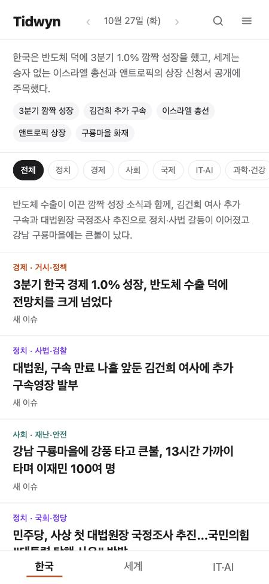

# Tidwyn

[한국어](README.md)

A personal news archive. Every day, AI gathers Korean, world, and IT/AI news, rewrites it in plain Korean, and links stories into issues so you can follow how events unfold.

- Site: <https://tidwyn.vercel.app>



## What it does

- **Daily briefs:** Top stories and short items in three sections (Korea, World, IT/AI). Each story has a one-line summary, why it matters, background, key facts, outlook, and sources.
- **Ongoing stories:** Stories are linked into issues, with earlier developments, an issue summary, a timeline, and related issues.
- **People, organizations, and countries:** Each one that appears in the news has a page with a one-line description and the stories and issues it appears in.
- **Glossary:** Difficult terms are collected with plain explanations. Tapping an underlined word in an expanded card opens its explanation right there.
- **Schedule calendar:** Upcoming official events mentioned in the news are collected in a list and a calendar, and linked to the news of their outcome once the date passes. The box above the brief shows "This week's schedule."
- **Key indicators:** Twelve indicators (the won-dollar rate, KOSPI and KOSDAQ, Korean and US policy rates and bond yields, oil prices, consumer prices, and the dollar index) come from official sources (Bank of Korea ECOS and FRED) and are shown on an indicators page with charts. The indicators tab of the box above the brief shows the values for that date, and issue pages show charts of related indicators.
- **Recommended videos:** Every day, AI picks long videos that offer real information and insight from YouTube's popular charts and topic and AI searches, in Korea, US, and AI groups. It checks their content with the Gemini API and writes a reason and an expandable summary for each pick. They appear in the brief's "Videos" tab and on related issue pages. Newly picked videos also get a section-by-section page that covers most of the video in text, and its timestamps open YouTube at that moment. Video information comes from YouTube API Services and is refreshed regularly. Videos removed from YouTube, or not refreshed within 30 days, are deleted ([privacy policy](https://tidwyn.vercel.app/privacy), Korean).
- **Builder:** From official sources on coding tools, models, security, frameworks, and platforms, AI picks only the changes worth knowing and lists zero to four a day in the brief's "Builder" tab. Each item has what changed, who is affected, what to do now, the deadline, why it was picked, and sources, and the count is never padded. Confirmed end-of-support and effective dates go on the schedule calendar, and pricing and limit figures are recorded on the days they change and kept in the public backup. The same tab also lists new products (Product Hunt API) and trending repositories (star growth measured by saving star counts daily through the GitHub API), zero to three of each a day. Each has its purpose, how it differs from existing tools, why it was picked, and its source, and repositories also show the license, maintenance status, stars, and growth. These texts are written by AI and are not recommendations or endorsements.
- **Read marks:** Stories you have read show in regular weight with a check in every list, and the brief can show unread stories only. The record stays in your own browser.
- **Browsing:** Category filters, a date list, an issue list, and on-site search, all usable on a phone.
- **Corrections and feeds:** Report mistakes with the "report an error" link on the site or by email (mivomad33@gmail.com). Corrected stories keep a "corrected" mark and a note on what changed. Briefs are available by RSS (<https://tidwyn.vercel.app/rss.xml>).

## How it works

1. Running the `/brief` skill in a local Claude Code session researches the previous day's news and writes it in a fixed format.
2. A script validates it, saves it to a local SQLite database, and links stories to issues. The database is the source of truth.
3. Demand signals (Google Trends trending searches, Mastodon trends) cannot be fetched for past dates later, so they are fetched daily and only their history is kept in a separate local database. They are not put on the site or in the backup, and are not published.
4. The whole database is exported as monthly JSON, committed to the `data` branch as a backup, and pushed.
5. A static site is built from the database and deployed to Vercel.


## Tech stack

- Collection and storage: TypeScript (Node 24, built-in `node:sqlite`), Claude Code skills
- Site: Vite, React, Pagefind (search), Vercel (hosting, Web Analytics)
- Tests: `node:test`

## Getting started

```bash
pnpm install
```

```bash
pnpm verify
```

- Daily collection runs with `/brief` in Claude Code. A trial run is `/brief test`.
- To view the site with generated sample data, run `pnpm site:dev`.
- To fetch indicators, videos, and new products, put the API keys (`ECOS_API_KEY`, `FRED_API_KEY`, `YOUTUBE_API_KEY`, `GEMINI_API_KEY`, `PRODUCT_HUNT_TOKEN`) in `.env.local` in the main working folder. Details are in the operations guide.
- Run conditions, manual deploys, rollbacks, and troubleshooting are in the [operations guide](docs/operations.md) (Korean).
- Project goals and stages are in the [project plan](docs/plan.md) (Korean).

## License and copyright

- The code is under the [MIT License](LICENSE).
- The brief and issue texts (the backup data on the `data` branch and the site content) are copyrighted by mivomad33 and may not be reused.
- Indicator values are data from Bank of Korea ECOS (including the compiling agencies) and FRED (the original sources), and their terms of use follow each source. This product uses the FRED® API but is not endorsed or certified by the Federal Reserve Bank of St. Louis.
- Video information (titles, thumbnails, and so on) belongs to YouTube and each channel, and follows the [YouTube Terms of Service](https://www.youtube.com/t/terms).
- The number rows in the public backup are copied from vendor documents, and their rights belong to each vendor. Rows from the Gemini documentation follow CC BY 4.0. Source attribution for builder items is on the [about page](https://tidwyn.vercel.app/about) (Korean).
- Original articles and images belong to their publishers. The site rewrites article text and links images by their original URLs only.
- The texts are written by AI and may contain errors. Please check the original articles for anything important.
